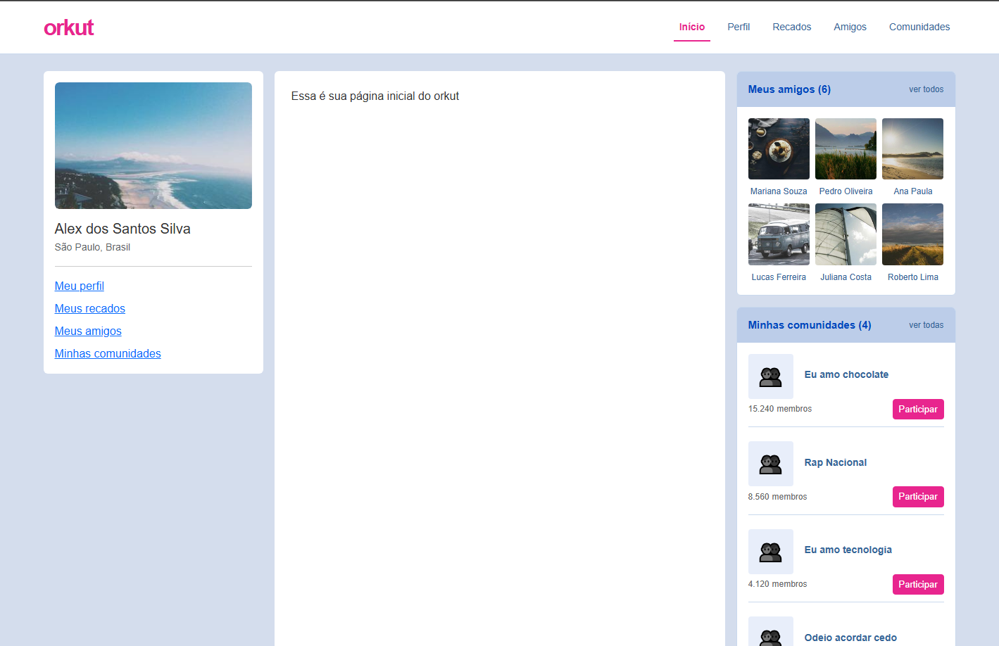

# Clone do Orkut

Aplicação web inspirada no Orkut, desenvolvida para estudar React, TypeScript e integração com uma API REST simulada.

O projeto reúne páginas de perfil, amigos, comunidades e um mural de recados. Foi criado para praticar componentes, rotas, organização do código, requisições HTTP e tratamento de erros.

> Projeto de estudo e portfólio, sem vínculo com o Orkut original.

## Demonstração

[Acessar o Clone do Orkut](https://devhome915.github.io/orkut/)

### Tela inicial



## Funcionalidades

- Navegação entre início, perfil, amigos, comunidades e recados.
- Página de perfil com identificador na rota.
- Listagem, criação, edição e exclusão de recados.
- Validação para evitar mensagens vazias.
- Modal de confirmação para salvar alterações e excluir recados.
- Notificações de sucesso e erro.
- Indicadores de carregamento e bloqueio de ações durante o salvamento.
- Modo API com JSON Server.
- Modo de demonstração que salva os recados no navegador.

## Tecnologias

| Tecnologia | Uso |
| --- | --- |
| React | Componentes e interface |
| TypeScript | Tipos dos dados e do código |
| Vite | Desenvolvimento e build |
| React Router | Navegação entre páginas |
| Bootstrap e Bootstrap Icons | Estilos e ícones |
| Context API | Compartilhamento das notificações |
| Fetch API | Requisições HTTP no modo API |
| JSON Server | API simulada para desenvolvimento |
| localStorage | Armazenamento de recados no modo demonstração |
| Oxlint | Análise estática do código |
| GitHub Actions | Verificação e publicação, quando o workflow estiver configurado |

## Como o projeto funciona

O componente da página de recados utiliza o hook `useScraps`, que chama as funções de `scrapService`. A variável `VITE_DATA_MODE` determina onde os dados são obtidos:

| Modo | Amigos | Recados |
| --- | --- | --- |
| `api` | Registros do JSON Server | Lidos e alterados no `db.json` |
| `demo` | Lista local de exemplo | Salvos no navegador com `localStorage` |

Os dados dos dois modos são separados. A lista da API e a lista local de amigos podem apresentar nomes e quantidades diferentes.

## Requisitos

- Git.
- Node.js 24.x com npm.
- Navegador atualizado.

Para verificar as versões instaladas:

```bash
git --version
node --version
npm --version
```

## Como executar

### 1. Obter o projeto

Se você ainda não possui uma cópia local:

```bash
git clone https://github.com/devhome915/orkut.git
cd orkut
```

Se já possui o projeto, abra o terminal na pasta que contém `package.json` e `db.json`.

### 2. Instalar as dependências

```bash
npm ci
```

Esse comando instala as dependências de acordo com o `package-lock.json`.

### 3. Configurar o ambiente

Crie o arquivo `.env.local` na raiz do projeto. Você pode copiar o arquivo de exemplo:

No Windows, usando PowerShell:

```powershell
Copy-Item .env.example .env.local
```

No Linux ou macOS:

```bash
cp .env.example .env.local
```

Se `.env.local` já existir, abra e edite esse arquivo, preservando as demais configurações que precisar.

Escolha o modo de execução:

**Modo API**

```dotenv
VITE_API_URL=http://localhost:3000
VITE_DATA_MODE=api
```

**Modo demonstração**

```dotenv
VITE_DATA_MODE=demo
```

No modo demonstração, `VITE_API_URL` pode permanecer configurada, mas os serviços de amigos e recados usam dados locais. Se `VITE_DATA_MODE` não for `demo`, esses serviços usam a API. Sem uma URL configurada, a aplicação usa `http://localhost:3000`.

O arquivo `.env.local` é ignorado pelo Git na configuração atual. Variáveis com prefixo `VITE_` ficam disponíveis no navegador; não coloque senhas ou chaves privadas nelas.

Reinicie o servidor do Vite após alterar as variáveis.

### 4. Iniciar o modo escolhido

**Modo API:** em um terminal, inicie o JSON Server:

```bash
npx json-server db.json --port 3000
```

Mantenha esse terminal aberto. Em outro terminal, inicie a aplicação:

```bash
npm run dev
```

Para conferir se a API está disponível, abra:

- Usuários: http://localhost:3000/users
- Recados: http://localhost:3000/scraps
- Dados de comunidades: http://localhost:3000/communities

O endpoint de comunidades existe no `db.json`, mas a existência dele não significa que todas as telas o utilizem.

**Modo demonstração:** com `VITE_DATA_MODE=demo`, inicie apenas a interface:

```bash
npm run dev
```

Nos dois casos, abra o endereço **exibido no terminal**. Com a base `/orkut/`, o endereço local normalmente será parecido com `http://localhost:5173/orkut/`. A porta pode mudar se estiver ocupada.

No modo demonstração, cada navegador mantém seus próprios recados. Esses dados podem ser apagados quando o armazenamento do navegador for limpo. Eles não são compartilhados entre visitantes.

## Rotas

O projeto utiliza `HashRouter`. Os caminhos abaixo aparecem depois de `#` no endereço:

| Caminho | Página ou comportamento |
| --- | --- |
| `/` | Página inicial |
| `/perfil` | Redirecionamento para o perfil do usuário local |
| `/perfil/:id` | Perfil com identificador na rota |
| `/recados` | Mural de recados |
| `/amigos` | Página de amigos |
| `/comunidades` | Página de comunidades |

Exemplo: `http://localhost:5173/orkut/#/recados`.

## Comandos disponíveis

| Comando | Finalidade |
| --- | --- |
| `npm ci` | Instalar dependências usando o arquivo de lock |
| `npm run dev` | Iniciar o servidor de desenvolvimento |
| `npx json-server db.json --port 3000` | Iniciar a API simulada |
| `npm run lint` | Verificar o código com Oxlint |
| `npm run build` | Verificar os tipos e gerar o build com Vite |
| `npm run preview` | Visualizar localmente um build já gerado |

Para validar e gerar o build:

```bash
npm run lint
npm run build
```

Para visualizar o build:

```bash
npm run preview
```

A configuração do modo de dados é incorporada durante o build. Portanto, escolha `VITE_DATA_MODE` antes de executar `npm run build` e gere o build novamente caso altere a variável. No modo API, mantenha o JSON Server ligado para os recursos que dependem dele.

O comando `preview` permite conferir o build na sua máquina; ele não publica o projeto.

## Organização do código

| Pasta ou arquivo | Responsabilidade |
| --- | --- |
| `src/components/` | Componentes da interface, incluindo recados, modal e notificações |
| `src/contexts/` | Contexto das notificações |
| `src/hooks/` | Hooks de recados e notificações |
| `src/layouts/` | Estrutura compartilhada das páginas |
| `src/pages/` | Páginas utilizadas nas rotas |
| `src/services/` | Serviços da API e do armazenamento local |
| `src/types/` | Tipos dos usuários, comunidades e recados |
| `src/data/` | Dados locais de apoio |
| `src/assets/` | Estilos e imagens |
| `src/App.tsx` | Definição das rotas |
| `src/main.tsx` | Inicialização do React, roteador e contexto |
| `db.json` | Dados do JSON Server |
| `.env.example` | Exemplo de configuração do ambiente |
| `.github/workflows/` | Arquivos dos workflows do GitHub Actions |

## API de recados

No modo API, os serviços utilizam os seguintes endpoints:

| Método | Endpoint | Operação |
| --- | --- | --- |
| GET | `/scraps` | Listar recados |
| POST | `/scraps` | Criar recado |
| PATCH | `/scraps/:id` | Atualizar mensagem |
| DELETE | `/scraps/:id` | Excluir recado |

Exemplo de dados para criar um recado:

```json
{
  "author": "Usuário de demonstração",
  "message": "Olá! Este é um recado de teste.",
  "createdAt": "2026-10-26T12:00:00.000Z"
}
```

## Validação manual

Execute os testes nos dois modos:

1. Abra as páginas de início, amigos, perfil, comunidades e recados.
2. Publique um recado e confirme a notificação de sucesso.
3. Atualize a página e confira se o recado continua aparecendo.
4. Tente publicar uma mensagem composta apenas por espaços.
5. Edite um recado, cancele e confira se a mensagem original permanece.
6. Edite novamente, salve e confirme no modal.
7. Cancele uma exclusão e confira se o recado continua na lista.
8. Exclua o recado e confirme no modal.
9. No modo API, interrompa o JSON Server e tente publicar um recado; confira o feedback de erro.
10. Reinicie a API e teste novamente.

No modo API, essas operações podem modificar o `db.json`. Utilize dados de teste e revise as alterações antes de fazer commits.

Este roteiro descreve testes manuais; não representa uma suíte automatizada.

## Publicação

O projeto está sendo preparado para publicação no GitHub Pages com GitHub Actions. O workflow proposto executa lint e build em Pull Requests e tenta publicar a versão de demonstração quando as alterações chegam à `main`.

O build de publicação deve utilizar `VITE_DATA_MODE=demo`. A publicação depende da configuração do GitHub Pages e de uma execução bem-sucedida do workflow.

## Solução de problemas

**Os dados não carregam no modo API**

- Confira se o JSON Server está em execução.
- Abra http://localhost:3000/users para verificar a resposta.
- Confira a variável `VITE_API_URL` em `.env.local`.
- Reinicie o Vite após alterar as variáveis.

**A porta 3000 está ocupada**

Inicie o JSON Server em outra porta:

```bash
npx json-server db.json --port 3001
```

Altere a URL no `.env.local`:

```dotenv
VITE_API_URL=http://localhost:3001
VITE_DATA_MODE=api
```

Reinicie o Vite.

**O Vite usa outra porta**

Abra o endereço exibido no terminal. O servidor pode escolher outra porta quando a padrão está ocupada.

**O modo alterado não aparece no preview**

Confira a configuração do ambiente e execute `npm run build` novamente antes de `npm run preview`.

**A instalação falha**

Confira as versões de Node.js e npm e leia a mensagem de erro. O arquivo de lock ajuda a reproduzir a instalação.

## Limitações atuais

- O JSON Server é uma API simulada com dados em arquivo.
- A demonstração usa armazenamento no navegador, separado para cada visitante.
- Não há autenticação real nem controle de acesso por usuário.
- Parte dos dados é mantida em arquivos locais.
- A navegação por teclado e o gerenciamento de foco do modal podem ser aprimorados.
- O projeto ainda pode receber testes automatizados para seus fluxos principais.

## Próximas melhorias

- Adicionar capturas reais da interface.
- Validar e publicar a demonstração no GitHub Pages.
- Criar testes automatizados para os fluxos de recados e erros.
- Melhorar o foco e a navegação por teclado no modal.
- Evoluir a API e estudar autenticação e autorização.

## Autor

Desenvolvido por **Alex dos Santos** como projeto de estudo e portfólio.

[GitHub — devhome915](https://github.com/devhome915)
